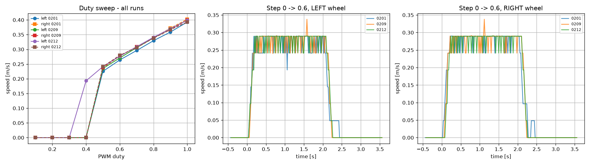
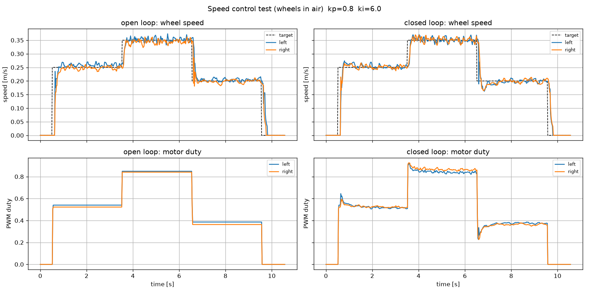

# Sentinel-Pi

Raspberry Pi 3B robot car built on the ET1 chassis, developed step by step
into an autonomous, sensor-fusion robot.

## Hardware
- Raspberry Pi 3B
- 2x DC motors with motor driver
- 2x wheel encoders
- HC-SR04 ultrasonic sensor
- 2x IR sensors
- Pi Camera (OV5647)

## Status
- [x] Remote access via SSH
- [x] Camera detected
- [x] Encoder pins found by GPIO scan
- [x] Ultrasonic verified
- [x] Motors verified
- [x] IR sensors identified
- [x] Phase 1: live camera stream Pi -> laptop (~32 fps, 640x480, ~20 kB/frame JPEG)
- [x] Phase 2: I/O server (50 Hz telemetry, watchdog, obstacle stop) + laptop teleop
- [x] Phase 3: motor characterization + wheel speed controller (feedforward + PI), wheels in air
- [ ] Phase 3b: floor test + distance calibration (first runs done; repeat with power bank mounted on the robot)

## Pin map (BCM)
| Function | GPIO |
|---|---|
| Motor left (PWM / IN1 / IN2) | 18 / 17 / 22 |
| Motor right (PWM / IN1 / IN2) | 19 / 24 / 4 |
| Encoder left / right (single channel) | 16 / 23 |
| Ultrasonic HC-SR04 trigger / echo | 25 / 27 |
| IR left / right | 20 / 21 |
| LED / button | 7 / 5 |

## Architecture
The Pi does fast I/O and safety; the laptop does the heavy computing.
- `pi/camera_server.py`: JPEG stream over ZeroMQ (port 5555)
- `pi/io_server.py`: 50 Hz sensor telemetry (port 5556), motor commands (port 5557),
  watchdog (motors stop after 0.3 s without commands), obstacle stop (< 15 cm)
- `laptop/camera_viewer.py`, `laptop/teleop.py`: live view, keyboard driving, CSV logging

## Structure
- `config/pins.py`: central GPIO pin map
- `robot/drive.py`: differential drive
- `tests/`: hardware test scripts

## Results

### Motor characterization (3 runs, wheels in air)
- Deadband: wheels start at 0.4-0.5 PWM duty (depends on motor temperature)
- Speed range 0.22-0.40 m/s, linear above 0.5 duty: left v = 0.324*duty + 0.075, right v = 0.314*duty + 0.086
- Repeatability: spread 1-2 % of speed
- Step response: dead time 40-60 ms, time constant ~0.1 s
- The left motor got ~3 % faster after warm-up, so a fixed calibration factor is not enough: feedback control is needed

### Wheel speed control
Speed is measured from the time between encoder edges (kernel timestamps via lgpio), with a 2 ms
glitch filter, because counting edges per 20 ms loop gives only 2-3 counts (too coarse).
Controller per wheel: motor-model feedforward + PI (kp 0.8, ki 6.0) + breakaway duty from standstill,
integrator anti-windup. Safety (watchdog, obstacle stop) runs after the controller and always wins.

| Profile 0.25 / 0.35 / 0.20 m/s | Open loop (model only) | Closed loop (model + PI) |
|---|---|---|
| Worst steady-state speed error | 3.6 % | 0.5 % |
| Left/right speed difference | up to 0.011 m/s | <= 0.001 m/s |

